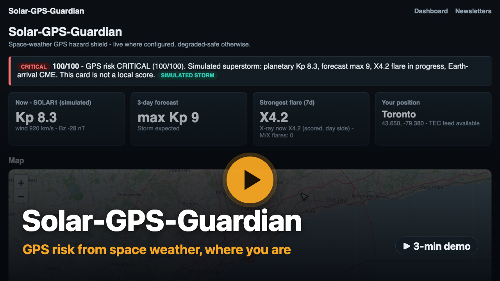

# Solar-GPS-Guardian

Live site: https://solar-gps-guardian.ninefruits.work/

[](https://youtu.be/WcxweZub2GA)

Demo video (3 min): https://youtu.be/WcxweZub2GA

A public space-weather dashboard and email alert for GPS risk. The score is
a fixed formula over open data. A language model may rewrite the sentence
only when it repeats that score. The same model also writes a monthly
newsletter: each issue aggregates last month's open-data archives
(DONKI events, Kyoto Dst, GFZ Kp, OMNI solar wind) into a short
retrospective with charts.

No login. A subscription is an email address and a region.

## Guides

- [Operation.md](docs/Operation.md): local commands, Modal serve and deploy, secrets, and what does not start a cron.
- [Manual.md](docs/Manual.md): the single page, badges, map, route, simulated storm, and subscribe. Includes screenshots.
- [Tech_Stack.md](docs/Tech_Stack.md): serverless layout, the snapshot, feed fallbacks, and how scores are served.
- [Pipeline_Study.md](docs/Pipeline_Study.md): what the risk score measures (weights, physics, limits) and the study that chose the data pipeline.

Recorded live checks from 2026-10-29 are in [sandbox/results](sandbox/results/README.md).

## What it does

Every 5 minutes the deployed service reads eleven open-data providers and
stores one snapshot. The page shows Kp, the 3-day forecast, the strongest
recent flare, a map, and a driving-route check. Subscribers get one daily
digest and an extra message when the storm rule trips. On the 1st of each
month the service publishes an LLM-written newsletter (site menu:
Newsletters) recapping last month's space weather from the archives.
A manual issue (`POST /newsletters/generate`, steps in
[Operation.md](docs/Operation.md)) uses the last complete month, so it
never duplicates the monthly cron run.

The score is 10 points per Kp (the largest of SWPC's current Kp, SWPC's
3-day forecast maximum, and the GFZ Kp nowcast), plus 15 while an M-class flare is in progress and 25 while an
X-class flare is in progress (GOES X-ray flux at snapshot time), 20 if an
Earth arrival of a CME is predicted (WSA-Enlil, from 72 hours ahead to 24
hours after it), and 10 if local vertical TEC is at least 50 TECU (a
large-delay level that low latitudes reach on many ordinary afternoons, not
a storm signal). Under 40 is LOW, under 70 is MODERATE, and 70 or more is
CRITICAL. The model does not calculate these numbers.

On the live view, the banner, each sample along a driving route, and each
subscriber's mail use this formula at that place: local TEC, a
geomagnetic-latitude weight on the Kp term, and no flare bonus on the night
side. The Kp weight is full anywhere the SWPC OVATION nowcast puts under the
auroral oval, and 10 more points apply where local TEC is at least 10 TECU
away from its 30-day median. A flare's X-rays reach only the sunlit side, and only while the flare
lasts. What reaches the night side later is the CME and the geomagnetic
storm, and the Kp and CME terms already apply everywhere. The full Kp weight
starts at 55 degrees of geomagnetic latitude and moves toward the equator in
strong storms (Kp above about 6), as the auroral zone does. To see how that route looks in a crisis, press the Simulate toggle.

If DONKI or the TEC feed is missing, the snapshot is marked degraded and the
SWPC readings still drive the score and the mail batch.

## Pipeline choice

Six designs were scored on 2026-10-26. The weights were GPS fidelity 25%,
lead time 20%, location and route specificity 15%, missing-feed behavior
15%, simplicity 10%, cost and keys 10%, and explainability 5%.

The adopted design is the layered hybrid (P4, weighted 4.60): SWPC indices,
DONKI events, TEC, and a GFZ Kp cross-check (the larger of SWPC and GFZ Kp
is scored, and a gap of 1 or more is named in the sentence). Kyoto Dst is
fetched for the record and the newsletter, not scored. TEC without DONKI
(P2, 3.65) is the fallback. SWPC alone (P1, 3.50) is the floor. Letting the model pick
the number (P5, 2.35) was rejected. The OMNI science archive (P6, 2.65)
stays off the live path. Details and the grid are in
[Pipeline_Study.md](docs/Pipeline_Study.md) and `pipeline-study-scorecard.csv`.

DONKI is read from `https://ccmc.gsfc.nasa.gov/DONKI-API/get/` with no API
key. `NASA_API_KEY` is still kept for a later client. That host timed out
from Ontario and answered from a Virginia container, so only the DONKI fetch
is pinned to a US Modal region.

Changes after the study (2026-10-31). The GFZ cross-check was listed in the
study but was not wired into the score until this date; it is now. Added:
the SWPC OVATION auroral-oval nowcast, the GloTEC deviation from its
30-day median, the flare term from the GOES X-ray flux at snapshot time
(secondary satellite when the primary reports 0), a 3-hour age limit on
the TEC grid, and a 5-minute ingest. Fixed: the CME term read the wrong
DONKI field and never fired; it now counts a WSA-Enlil Earth shock arrival
from 72 hours ahead to 24 hours after it. Details are in
[Pipeline_Study.md](docs/Pipeline_Study.md).

## Run

```bash
uv run python -m unittest discover -s backend/tests
uv run python -m backend.run_local
cd frontend && npm install && npm run dev
```

Deploy and the Modal URL are in [Operation.md](docs/Operation.md). The design
record is [implementation.md](docs/implementation.md).

## Acknowledgements

Thanks to Meta, Baseten, and Modal for the credits that made this project possible.
