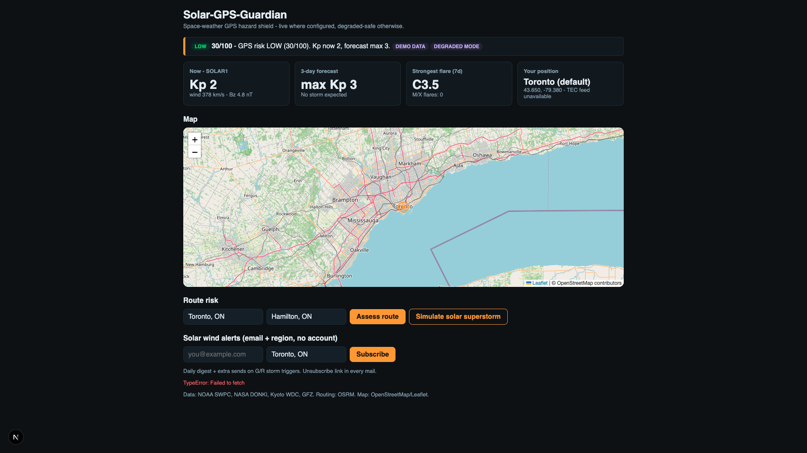
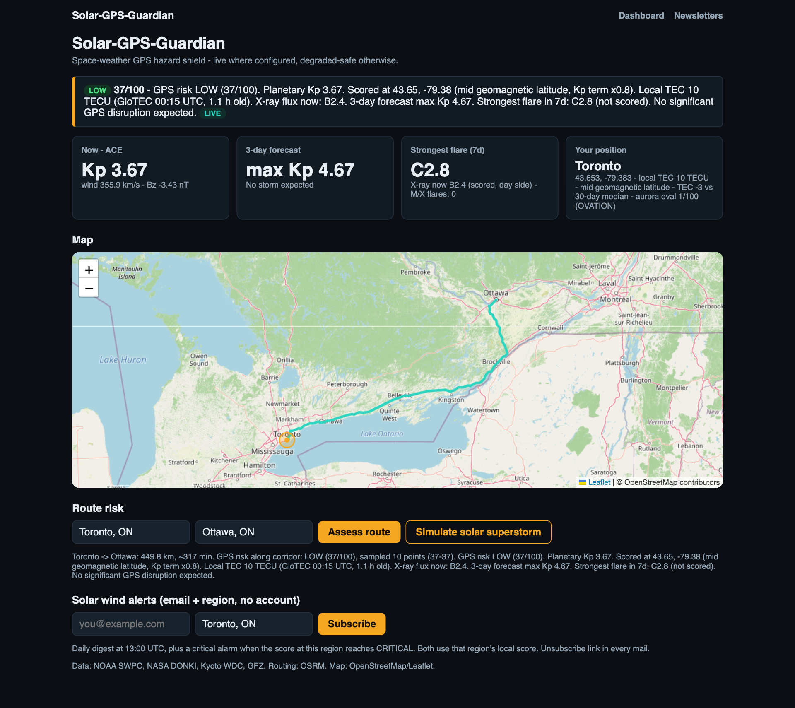
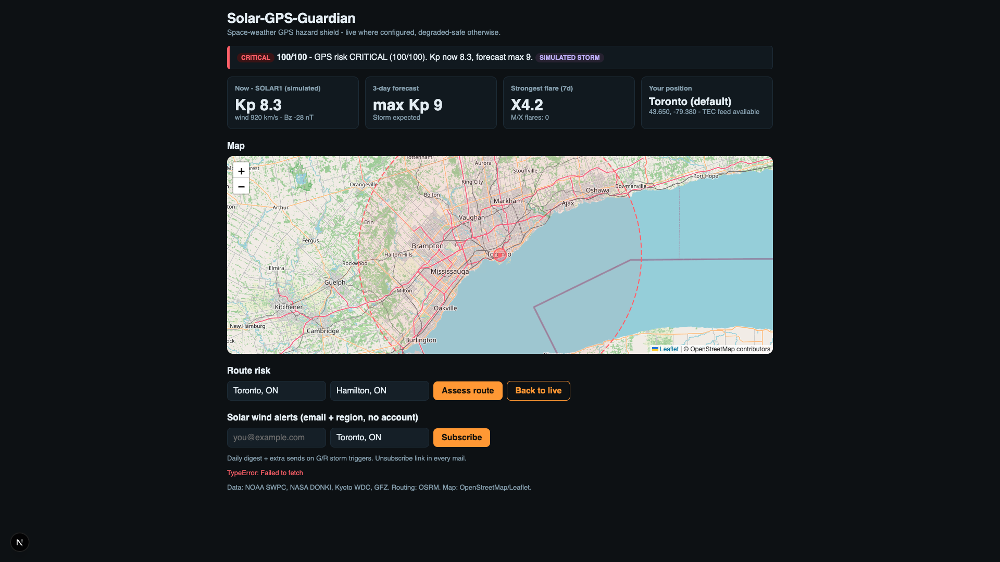
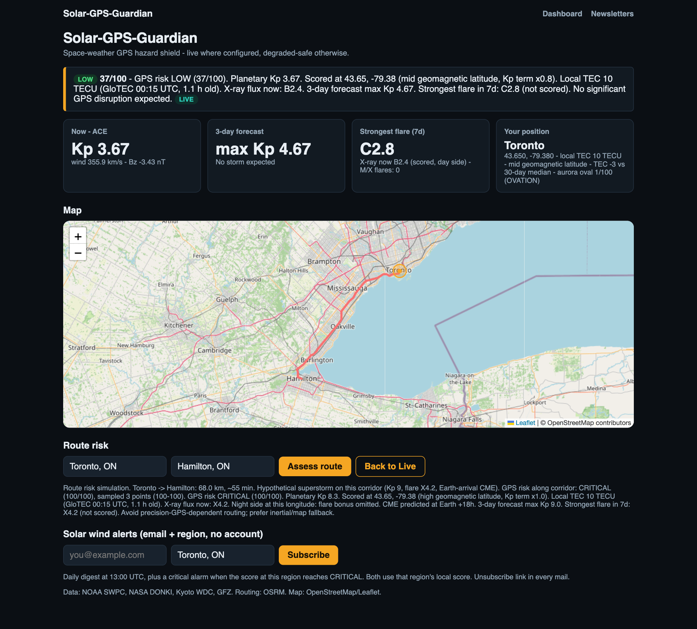
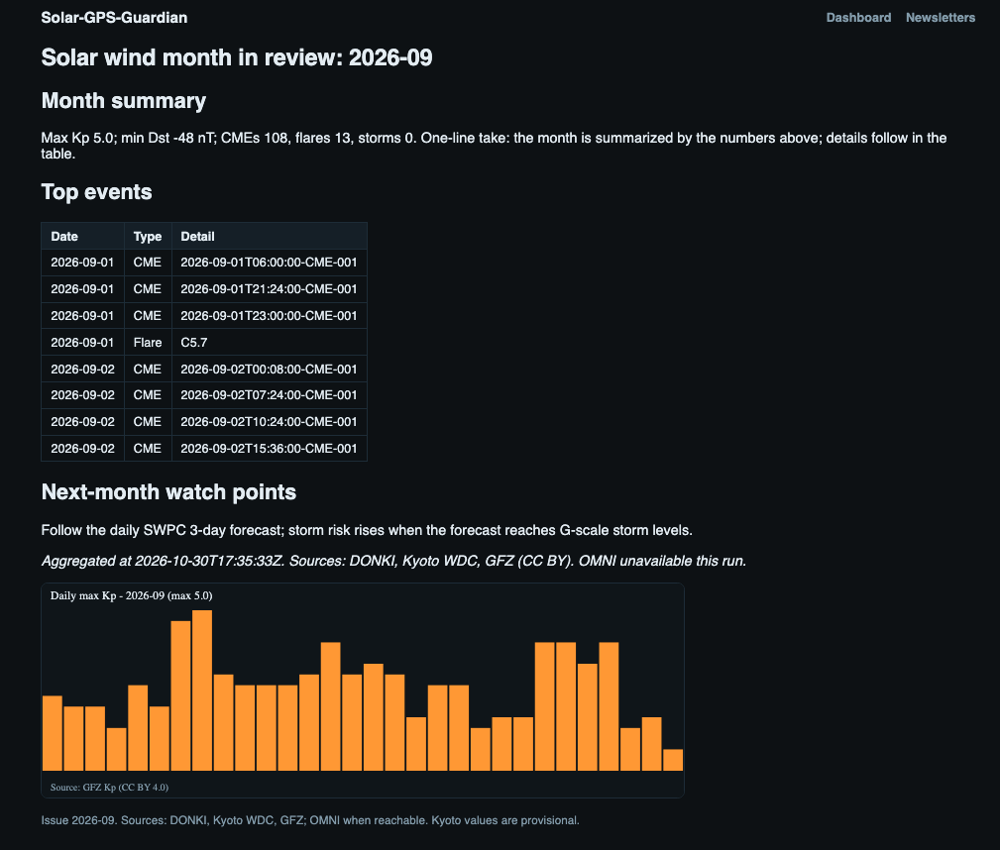

# User interface

The site has a dashboard and a monthly newsletter. The dashboard shows the
current GPS risk, a map, a route check, and an email subscription. There is
no account and no login. The header links Dashboard and Newsletters.

The screenshots were taken on 2026-10-31 at 20:12 UTC from a production
build (`next build`, `next start`) at a 1280-pixel-wide window, with the
browser position set to Toronto. The live captures use the current backend
code on that hour's live feeds. The demo capture uses an empty
`NEXT_PUBLIC_API_BASE`, so the page shows the built-in sample and Subscribe
reports that nothing was stored. With a real Modal URL the badge switches to
LIVE when `GET /snapshot` succeeds.

## Live snapshot

`GET /snapshot` succeeded, so the badge is LIVE. The banner is the
`/local-score` result for Toronto: MODERATE, 40/100. The Kp term uses the
largest of the SWPC current Kp (3.33, from ACE), the GFZ nowcast, and the
3-day maximum (Kp 5), times
0.8 for Toronto's mid geomagnetic latitude: 5 x 10 x 0.8 = 40. The current
X-ray class is B3.2, below M, so there is no flare bonus. The strongest
flare in seven days is C2.8, shown but not scored. Local TEC is 31 TECU,
under the 50 TECU threshold. DEGRADED MODE is absent because both DONKI and
TEC were present in this snapshot. The amber pin is on Toronto.

## Demo data

The banner is a fixed label for the built-in sample, not a server score:
LOW, 30/100, for the demo's Kp 2 and 3-day maximum of Kp 3. The sample has
no DONKI or TEC data, so DEGRADED MODE is shown next to DEMO DATA.

| Badge | Meaning |
|---|---|
| LOW, MODERATE, CRITICAL | Score bands: under 40, 40 to 69, 70 and above. |
| DEMO DATA | No live snapshot. The page is using the built-in sample. |
| LIVE | `GET /snapshot` returned a snapshot. |
| DEGRADED MODE | DONKI or GloTEC was missing in this snapshot. The sentence names which one. The score still uses every feed that answered (SWPC Kp, GOES X-ray, OVATION, and a TEC grid up to 3 hours old). |
| SIMULATED STORM | The view is the superstorm card. The numbers are not a measurement. |

The four cards are the current solar-wind sample, the 3-day forecast
maximum Kp, the strongest flare in seven days, and the browser position.
The position card adds the local TEC deviation from its 30-day median and
the OVATION aurora value when those grids cover the place. The flare card
also prints the current GOES X-ray class. Only that current
class is scored, and only on the day side. The seven-day flare is shown for
context.
Until geolocation answers, the position is Toronto. TEC on the demo sample
is unavailable.

The map is Leaflet on OpenStreetMap tiles, centered on that position. An amber pin marks the position. Leaflet's bundled marker image is not served by Next.js, so the pin is drawn by the page.

## Route

From and To are place names. Assess route asks Nominatim for coordinates and
OSRM for a driving path. Those two calls stay in the browser. The page draws
the full path and prints distance and duration. In the capture above
(2026-11-01, 01:25 UTC), Toronto to Ottawa is 449.8 km, about 317 minutes.
All 10 samples scored LOW, 37/100 (range 37-37), so the line is teal.

The corridor score is not the banner score copied onto the line. The page
samples the OSRM line at equal distances along the road: about one point
every 50 km, at least 2 (the start and the end) and at most 16. Toronto to
Hamilton (68 km) gets 3 points, Toronto to Ottawa (450 km) 10 points 50 km
apart, and Toronto to Chicago (839 km) 16 points 56 km apart. The points
are interpolated on the line, so they need not be OSRM vertices. (OSRM
puts vertices densely in towns and sparsely on highways, so the earlier
every-k-th-vertex sampling left gaps from 17 to 104 km on Toronto to
Ottawa.) Those points go to `POST /route-score`.

Each sample uses the same score as the banner and the mail: nearest TEC
cell, geomagnetic-latitude band on the Kp term only (the high band reaches
farther south in strong storms), and no bonus for a flare in progress on the
night side. Planetary Kp, the 3-day forecast, and any Earth-arrival CME
are the same at every sample. What can differ along the road is TEC, the
latitude band, and day or night. The server accepts at most 16 points.

The number in the sentence is the highest sample, not the average. A quiet
stretch does not pull that number down. The same sentence prints the lowest
and highest scores in the sample, and the advisory belongs to the highest
point. The line color follows that highest level: red at CRITICAL, teal at
LOW, amber otherwise.

If Nominatim or OSRM fails, no path is drawn. The sentence names the
failure and keeps the position score. If the path arrives and
`/route-score` does not, the path stays on the map and the sentence says
the local route score is unavailable. The superstorm step does not sample
the path. It colors an existing line from the storm card. The next step,
Simulate Route Risk, does sample the path.

## Simulated storm

One button cycles through three views. The label is the next view.

1. Live. The button reads Simulate solar superstorm. The banner is the
   position score.
2. Superstorm. The first click replaces the snapshot with fixed storm
   numbers: Kp 8.3, forecast maximum Kp 9, an X4.2 flare in progress, and an
   Earth-arrival CME. The banner becomes CRITICAL, 100/100, and the badge
   says SIMULATED STORM. The map center and zoom return to the Toronto
   region (zoom 9), From and To reset to Toronto, ON and Hamilton, ON, and
   any path already on the map is cleared. The pin turns red, and a dashed
   circle is drawn around Toronto. This step does not score route samples.
   The button
   then reads Simulate Route Risk. The capture above is this card.
3. Route risk. The next click returns the banner to the live position
   score and scores the current From and To fields. Those fields start as
   Toronto, ON and Hamilton, ON. The page draws that OSRM path, samples it
   the same way (3 points for Toronto to Hamilton), and posts them to
   `/route-score` with `scenario` set to `storm`. The server scores those samples with the same superstorm
   numbers (Kp 8.3, forecast maximum Kp 9, an X4.2 flare in progress, one
   Earth-arrival CME); the live GFZ Kp is left out of this hypothetical. The clock and the TEC grid stay live, so night side
   and local TEC still change the sample. The line color and the sentence
   use the highest of those hypothetical samples. The button then reads
   Back to Live.

   

   In this capture every sample is CRITICAL, 100/100, and the line is red.
   Under Kp 9 the high latitude band starts at 49.8 degrees, so Toronto
   (53.0 degrees geomagnetic) keeps the full Kp term (x1.0) instead of the
   0.8 it gets on a quiet day.
4. The next click clears that path and returns to the live view.

None of these steps writes the database or sends mail.

## Subscribe

Email and region do not create an account. Subscribe geocodes the region
name and sends `POST /subscribe` with the email, latitude, longitude, and
region. The server stores that row and returns an unsubscribe token.

If the API base is empty, the button does not call a server. The message is
"Demo mode: no backend configured, subscription NOT stored." If the base is
set and the host is down, the message is a fetch error.

A stored subscription receives one daily digest, subject "Solar wind daily
digest". An extra message, subject "Solar wind Critical Alarm", is sent only
when a 6-hour check sees CRITICAL. MODERATE, including a G1 forecast, stays
in the daily digest. Every message contains an unsubscribe link. The link is
checked with `UNSUBSCRIBE_SECRET`.

## Monthly newsletter

Newsletters opens one issue. This capture is the September 2026 issue
written by the template, which is used when the language-model call fails.
The one-line take says the month is summarized by the numbers above.

The summary line is max Kp 5.0, minimum Dst -48 nT, 108 CMEs, 13 flares,
and 0 storms. Top events lists the first CME and flare rows. Next-month
watch points tell the reader to follow the daily SWPC 3-day forecast. The
bar chart is the daily maximum Kp from GFZ. The footer notes that OMNI was
unavailable for this run, and that Kyoto values are provisional.
